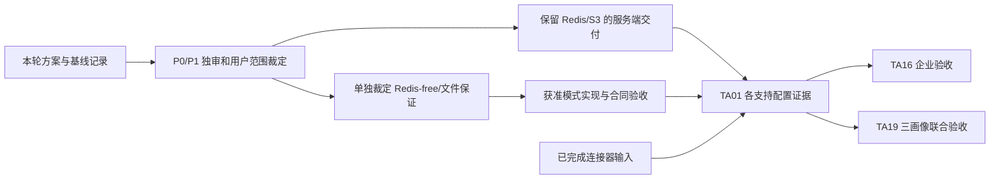

# TA01 验收设计与责任

## 当前基础产品验收范围

用户已批准基础产品及现有 Linux amd64／arm64 CI、干净完整 guest。此矩阵保留原 DoD 和九类要求；本轮新增验收只覆盖 PG／Redis／S3 三画像，Redis-free／filesystem 继续列为后续未交事项，不能记已实现或移除原提案。

旧控制面基线和 docs Required CI 不替代新候选包验收。当前只完成仓库阶段同步，平台 Saved plan 同步关口未完成，产品代码和产品验收尚未开始。

## 原要求承接

当前完整规格见 [spec.md](spec.md)，旧原件见 [history](history/README.md)。以下用例进入已批准基础范围时必须实际执行，不能因文档检查或历史成果通过而勾选。

| 原测试项／DoD | 既有输入 | 待创建或补充的准确目标 | 责任及状态 |
| --- | --- | --- | --- |
| 空白无源码设备安装 | `scripts/verify-a2-backend-lite.mjs` 的 Git archive、镜像 save/load、无源码安装目录；#20 连接器产物 | `scripts/server-distribution/install.test.mjs`：`blankInstallWithoutSource`、`wrongArchitectureRejectedBeforeMutation`、`offlineDependencyClosure` | TA01；Linux 双架构真实 OS 与 Docker 条件待裁定，未测 |
| 已有版本升级／回退／卷保留 | `packages/db/integration/migration-baseline.integration.test.ts` 的 restart-idempotently、并发 runner 和 checksum 拒绝 | 同上：`upgradeKeepsOriginalVolumes`、`preMigrationFailureKeepsCurrent`、`partialMigrationStopsIncompatibleRollback`、`compatibleProgramRollback`、`restoreIntoEmptyTargetKeepsOriginal` | TA01；待创建，真实新旧版本对和 journal 故障注入必需 |
| 各支持配置完整操作链 | 后端退役 API Cookie／CSRF、provider 幂等及精确上下文；独立 MCP 配对和 Skill 下载 | `apps/api/integration/deployment-profiles.integration.test.ts`：`personalJourney`、`teamJourney`、`enterpriseJourney`；不得跳过 Worker／outbox、限流、上传下载和完整恢复 | TA01 提供配置证据；TA16 企业组合；TA19 最终联合验收 |
| 停 Redis、丢 hint、worker 重启 | coordinator 的 fallback／重复 hint；outbox 的 offline／restart／backoff／dead 测试 | 同上：`redisOutageFailsClosedCredentials`、`databaseModeHasNoRedisClient`、`lostWakeupStillReadsCommittedCursor`、`crashAfterClaimRecovers`、`consumerReplayDoesNotDuplicateEffect` | 现有 Redis 故障回归可复用；Redis-free 用例待创建且先裁定 |
| 不支持组合启动拒绝 | config 与 runtime-guard、Lite 未知角色拒绝 | `packages/config/src/deployment-profile.test.ts`：`rejectUnsupportedBeforeSideEffect`、`rejectReplicaOrStoreMismatch`、`rejectUntrustedProxyAndMissingCa` | TA01；待创建；当前未知变量不保证拒绝 |
| 固定资源及空闲／首任务／并发峰值 | 本轮[测量方法与状态](measurement.md) | `scripts/server-distribution/measure.mjs`：输出固定条件、原样 samples、errors 和 ledger；真实受限设备重新完整采样 | TA01；Docker 基线不是设备最低值，资源数字不预写 PASS |
| schema 变更 | manifest／账本／SQL 原子注册及上一阶段升级回归 | `packages/db/integration/deployment-profile-migration.integration.test.ts`：`cleanInstall`、`previousStageUpgrade`、`failureRollsBackSqlAndLedger` | 基础交付无 schema；PG 限流等获准后新增编号迁移与 SCHEMA，待创建 |
| 每项声明均可复现，无 failing required check | 当前五项 required checks 和实际 Required CI 策略 | 新组合真实演练与候选源码／镜像／环境绑定，按每个支持格给独立结果 | 旧 CI 仅作输入；本轮不报告产品 DoD 完成 |
| 完整证据、演示、限制与偏差、独审 | 本轮文档入口、来源与验证页 | 后续源代码／迁移／API／events、完整测试、演示和首败证据同次交付 | P0/P1 独审仍必需；失败与未测不能按较低审查等级豁免 |

上述待创建文件及用例名是冻结的实施目标。基础安装、升级、配置、真实恢复及三画像用例已获准；Redis-free／filesystem 专属用例保持后续待裁定。后续保证批准改变目标时，须明确修订并保留历史原件。

## 九类适用测试

| 类别 | 具体场景与现有复用 | 后续新用例 |
| --- | --- | --- |
| happy path | backend-retirement 的 `liteInstallCookieCsrf`、`liteProviderConnectionReplay`、`liteExactProjectContext`；恢复整体链 | `personalJourney`／`teamJourney`／`enterpriseJourney`，每格含工件读回和恢复 |
| 越权 | Cookie／CSRF 缺失、其他 Human、撤权后的读取拒绝；Session、delegation、capability、scope 沿领域测试 | `crossTeamArtifactAndProfileReadDenied`、`revocationDuringUploadDenied` |
| 非法状态 | 已结束 Session 写入拒绝，已完成／取消 intent；失效 journal 和不兼容回退 | `terminalSessionCannotWriteInAnyProfile`、`invalidInstallJournalRefused` |
| 重复幂等 | provider 同 key 原响应与异体拒绝；安装并发控制 | `installRetryUsesSameJournalIdentity`、`uploadFinalizeReplaySameResult` |
| 旧 revision | API mutation 的 If-Match；画像不能绕过领域入口 | `staleRevisionRejectedInEveryProfile` |
| 事务失败 | migration SQL／ledger、领域 state／event／outbox 同事务 | `profileMutationRollbackKeepsStateEventOutboxAligned`、`limiterAtomicMultiDimensionFailure` |
| webhook／job 重放 | outbox／webhook 真实 worker＋fake Agent；恢复重放不重做外部效果 | `consumerReplayDoesNotDuplicateEffect`、`restoreJournalSameTargetReplay` |
| 并发 | 三维限流、上传同对象、双安装器、双迁移器和资源 fencing | `concurrentInstallHasOneOwner`、`concurrentLimiterOneBudget`、`concurrentUploadNoOverwrite` |
| 重启／outbox 恢复 | coordinator 的 startup／restart；worker claim 后恢复；recovery 中断 journal | `crashAfterClaimRecovers`、`restartBetweenFileAndMetadataCommit`、`restartDuringUpgradeKeepsDeterminateState` |

领域九类全部适用于最终产品组合；本轮仅文档和只读采样，不增加领域 mutation，因此不新建对应领域回归。测量中使用既有 API 写入独有测试库，不等于新功能 happy path 验收。

后续 `apps/api/integration/deployment-profiles.integration.test.ts` 承载 API 场景；store 单元与 conformance 另建 `apps/api/src/auth-rate-limit/database-store.test.ts`、`packages/artifact-storage/src/filesystem.test.ts`。真实 Redis／PG／S3 用例与 fake store 场景分列，不以模拟结果代替真实原子性、锁、限流或保留。

## 基础、保证与联合验收顺序

保证分支未获准时，不纳入基础交付的支持矩阵；图中合流表示获准后补其证据，不要求未批准模式阻塞已保留 Redis/S3 的基础范围。TA19 全卡完成仍受其其他责任卡依赖约束，本方案不取消这些依赖。

## 真实环境条件与命令

个人设备验收要冻结 OS、架构、Docker／Compose、CPU／RAM、磁盘介质及容量、网络和 CA；团队另冻结人数、并发和数据量；企业另冻结身份、内网 Git／模型／S3 及受限出网规则。当前未提供的条件保持待裁定，不默认申请新设备、凭据或真实外发。连接器自身 D-Bus／Secret Service 条件沿 #20，不接管其实现。

后续产品执行 `pnpm lint`、`pnpm typecheck`、`pnpm test`、`pnpm test:integration`、`pnpm test:conformance`，再运行每格安装／API／MCP／Worker／限流／工件／恢复闭环。根 `test:e2e` 已不存在，历史后端断言按当前入口承接，不恢复浏览器 CI。

复用实测入口包括 `pnpm validate:lite`、`pnpm validate:production-images`、`node scripts/verify-a2-backend-lite.mjs`、`pnpm verify:integration-examples --recovery-checks`。最后一项的恢复套件为显式 opt-in；只跑普通 integration 成功不能表示已运行恢复。全部仅对准确独有测试库和 bucket 运行。

后续新增用例的生产 build 排除、unit／integration／conformance 分类和必需 CI 消费必须同步核实，不能把测试文件存在当执行证据。源码、runner checkout、镜像身份、原日志、未测及资源收尾分别绑定。
