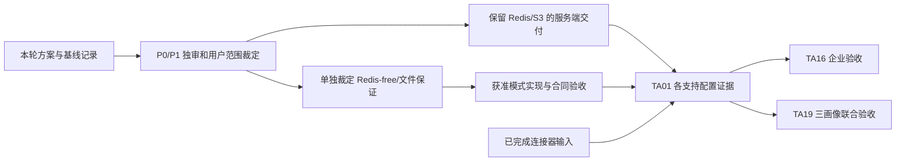

# TA01 验收设计与责任

本次按用户 2026-10-14 12:27 批准的新会话方式接续。PR227 为恢复来源，本次交付和条件合入走当前会话分支；旧树保全、真实主线及双架构首败见 [接续记录](resumption.md)。产品验收尚未完成。

## 当前基础产品验收范围

用户已批准基础产品及现有 Linux amd64／arm64 CI、干净完整 guest。此矩阵保留原 DoD 和九类要求；本轮新增验收只覆盖 PG／Redis／S3 三画像，Redis-free／filesystem 继续列为后续未交事项，不能记已实现或移除原提案。

旧控制面基线和 docs Required CI 不替代新候选包验收。用户已批准本阶段记录例外并继续。平台 Saved plan 字段仍未同步，当前依据仓库执行计划进入产品实现；产品验收已有局部真实结果，三画像双架构完整组合尚未通过；最新准确源码、首败及未测见 [接续记录](resumption.md)。

## 原要求承接

当前完整规格见 [spec.md](spec.md)，旧原件见 [history](history/README.md)。以下用例进入已批准基础范围时必须实际执行，不能因文档检查或历史成果通过而勾选。

| 原测试项／DoD | 既有输入 | 待创建或补充的准确目标 | 责任及状态 |
| --- | --- | --- | --- |
| 空白无源码设备安装 | `scripts/verify-a2-backend-lite.mjs` 的 Git archive、镜像 save/load、无源码安装目录；#20 连接器产物 | `scripts/server-distribution/install.test.mjs`：`blankInstallWithoutSource`、`wrongArchitectureRejectedBeforeMutation`、`offlineDependencyClosure` | TA01；Linux 双架构 CI 和干净完整 guest 已批准，未测 |
| 已有版本升级／回退／卷保留 | `packages/db/integration/migration-baseline.integration.test.ts` 的 restart-idempotently、并发 runner 和 checksum 拒绝 | 同上：`upgradeKeepsOriginalVolumes`、`preMigrationFailureKeepsCurrent`、`partialMigrationStopsIncompatibleRollback`、`compatibleProgramRollback`、`restoreIntoEmptyTargetKeepsOriginal` | TA01；待创建，真实新旧版本对和 journal 故障注入必需 |
| 各支持配置完整操作链 | 后端退役 API Cookie／CSRF、provider 幂等及精确上下文；独立 MCP 配对和 Skill 下载 | `apps/api/integration/deployment-profiles.integration.test.ts`：`personalJourney`、`teamJourney`、`enterpriseJourney`；不得跳过 Worker／outbox、限流、上传下载和完整恢复 | TA01 提供配置证据；TA16 企业组合；TA19 最终联合验收 |
| 停 Redis、丢 hint、worker 重启 | coordinator 的 fallback／重复 hint；outbox 的 offline／restart／backoff／dead 测试 | 同上：`redisOutageFailsClosedCredentials`、`databaseModeHasNoRedisClient`、`lostWakeupStillReadsCommittedCursor`、`crashAfterClaimRecovers`、`consumerReplayDoesNotDuplicateEffect` | 现有 Redis 故障回归可复用；Redis-free 用例待创建且先裁定 |
| 不支持组合启动拒绝 | config 与 runtime-guard、Lite 未知角色拒绝 | `packages/config/src/deployment-profile.test.ts`：`rejectUnsupportedBeforeSideEffect`、`rejectReplicaOrStoreMismatch`、`rejectUntrustedProxyAndMissingCa` | TA01；待创建；当前未知变量不保证拒绝 |
| 固定资源及空闲／首任务／并发峰值 | 本轮[测量方法与状态](measurement.md) | `scripts/server-distribution/measure.mjs`：输出固定条件、原样 samples、errors 和 ledger；真实受限设备重新完整采样 | TA01；Docker 基线不是设备最低值，资源数字不预写 PASS |
| schema 变更 | manifest／账本／SQL 原子注册及上一阶段升级回归 | `packages/db/integration/deployment-profile-migration.integration.test.ts`：`cleanInstall`、`previousStageUpgrade`、`failureRollsBackSqlAndLedger` | 基础交付无 schema；PG 限流等获准后新增编号迁移与 SCHEMA，待创建 |
| 每项声明均可复现，无 failing required check | 当前五项 required checks 和实际 Required CI 策略 | 新组合真实演练与候选源码／镜像／环境绑定，按每个支持格给独立结果 | 旧 CI 仅作输入；本轮不报告产品 DoD 完成 |
| 完整证据、演示、限制与偏差、独审 | 本轮文档入口、来源与验证页 | 后续源代码／迁移／API／events、完整测试、演示和首败证据同次交付 | P0/P1 独审仍必需；失败与未测不能按较低审查等级豁免 |

上述待创建文件及用例名是冻结的实施目标。基础安装、升级、配置、真实恢复及三画像用例已获准；Redis-free／filesystem 专属用例保持后续待裁定。后续保证批准改变目标时，须明确修订并保留历史原件。

## 九类适用测试

当前新增入口已经创建：`packages/config/src/deployment-profile.test.ts` 校配置拒绝；`scripts/server-distribution/install.test.mjs` 校清单、账本、程序兼容、目录锁及 journal；`apps/api/integration/deployment-profiles.integration.test.ts` 校匿名请求没有状态／event／outbox 写入。完整三画像由 `scripts/server-distribution/guest.py` 的 `journey`、`upgrade_recovery` 和重启分支执行，安装器单元不能代替 guest。

| 已创建入口／真实范围 | 当前状态 |
| --- | --- |
| guest：API 安装、Cookie／CSRF、provider 私有 CA HTTPS、配对 MCP、上传／worker 验证／下载 | 未执行完成；首批候选不宣称支持 |
| guest：真实凭据 429／Retry-After、停 Redis 的凭据失败关闭、停 worker 时 PG outbox 留存、重启后 delivered、并发请求和周期采样 | 未执行完成；新增 realCredentialRateLimit429 尚待新候选实测，Root 集成回归是独立输入 |
| guest：同程序两候选升级、完整加密备份、兼容回退、真实未知账本拒绝、健康失败后实际停止不兼容候选、独立空目标恢复、原卷身份 | 未执行完成；不是两个已发行历史程序版本，裸 Compose 迁入未实现 |
| guest：两次 kernel／boot_id 与 QMP RESET／SHUTDOWN，实际已安装服务重启 API／MCP 读取、原工件字节和新 outbox 投递 | 未执行完成；不以 hosted 架构标签或 Docker healthy 代证 |
| 根 lint／typecheck／test／integration／conformance；独立恢复 opt-in | 38a8923 加正式 Pi 摘要测试修正的规范五门禁全部通过，695 个输入前后相同，无临时观测／preload；此前 M5 首败及观测另保。根 recovery opt-in 仍跳过，CI549 真实 PG／S3 恢复和恢复后生产镜像 smoke 另通过。后续诊断修改的21项 Python／15项安装单元通过，新完整 CI 待执行；CI549 AMD64 团队回退后 MCP 初始化连接重置，ARM64 个人升级后工具读取超时，双架构及 Required 失败。准确源、首败与收尾见 resumption.md，当前不能合入 |

下面的历史冻结用例名继续保留。已有等效入口的真实名字和范围以上表为准；尚未完成的新场景仍是待创建或待执行责任，不因函数、配置或旧测试存在而勾选。Redis-free／filesystem 专属用例维持后续裁定。

既有真实用例复用包括 `apps/worker/integration/outbox-recovery.integration.test.ts` 的 `restarts after a committed claim and delivers the recovered event to the receiver`、`keeps a Redis hint pending while offline and delivers it after recovery`；`packages/db/integration/migration-baseline.integration.test.ts` 的上一阶段原子升级／失败回滚；`packages/recovery/integration/recovery.integration.test.ts` 的 `backs up, safely resumes an interrupted empty-target restore, and verifies all state`。越权、撤权和字段读取沿 `apps/api/integration/route-policy-authorization.integration.test.ts` 的现行真服务断言，不能将 fake actor／provider 说成企业实网身份验收。

| 类别 | 具体场景与现有复用 | 后续新用例 |
| --- | --- | --- |
| happy path | backend-retirement 的 `liteInstallCookieCsrf`、`liteProviderConnectionReplay`、`liteExactProjectContext`；恢复整体链 | `personalJourney`／`teamJourney`／`enterpriseJourney`，每格含工件读回和恢复 |
| 越权 | Cookie／CSRF 缺失、其他 Human、撤权后的读取拒绝；Session、delegation、capability、scope 沿领域测试 | `crossTeamArtifactAndProfileReadDenied`、`revocationDuringUploadDenied` |
| 非法状态 | 已结束 Session 写入拒绝，已完成／取消 intent；失效 journal 和不兼容回退 | `terminalSessionCannotWriteInAnyProfile`、`invalidInstallJournalRefused` |
| 重复幂等 | provider 同 key 原响应与异体拒绝；安装并发控制 | `installRetryUsesSameJournalIdentity`、`uploadFinalizeReplaySameResult` |
| 旧 revision | API mutation 的 If-Match；画像不能绕过领域入口 | `staleRevisionRejectedInEveryProfile` |
| 事务失败 | migration SQL／ledger、领域 state／event／outbox 同事务 | `profileMutationRollbackKeepsStateEventOutboxAligned`、`limiterAtomicMultiDimensionFailure` |
| webhook／job 重放 | outbox／webhook 真实 worker＋fake Agent；恢复重放不重做外部效果 | `consumerReplayDoesNotDuplicateEffect`、`restoreJournalSameTargetReplay` |
| 并发 | 三维限流、上传同对象、双安装器、双迁移器和资源 fencing | `concurrentInstallHasOneOwner`、`concurrentLimiterOneBudget`、`concurrentUploadNoOverwrite` |
| 重启／outbox 恢复 | coordinator 的 startup／restart；worker claim 后恢复；recovery 中断 journal | `crashAfterClaimRecovers`、`restartBetweenFileAndMetadataCommit`、`restartDuringUpgradeKeepsDeterminateState` |

领域九类全部适用于最终产品组合；基础产品实现保持领域 mutation 入口，复用并执行既有领域回归和新增部署组合验收。测量中使用既有 API 写入独有测试库，不等于新功能 happy path 验收。

后续 `apps/api/integration/deployment-profiles.integration.test.ts` 承载 API 场景；store 单元与 conformance 另建 `apps/api/src/auth-rate-limit/database-store.test.ts`、`packages/artifact-storage/src/filesystem.test.ts`。真实 Redis／PG／S3 用例与 fake store 场景分列，不以模拟结果代替真实原子性、锁、限流或保留。

## 基础、保证与联合验收顺序

保证分支未获准时，不纳入基础交付的支持矩阵；图中合流表示获准后补其证据，不要求未批准模式阻塞已保留 Redis/S3 的基础范围。TA19 全卡完成仍受其其他责任卡依赖约束，本方案不取消这些依赖。

## 真实环境条件与命令

个人设备验收要冻结 OS、架构、Docker／Compose、CPU／RAM、磁盘介质及容量、网络和 CA；团队另冻结人数、并发和数据量；企业另冻结身份、内网 Git／模型／S3 及受限出网规则。当前未提供的条件保持待裁定，不默认申请新设备、凭据或真实外发。连接器自身 D-Bus／Secret Service 条件沿 #20，不接管其实现。

后续产品执行 `pnpm lint`、`pnpm typecheck`、`pnpm test`、`pnpm test:integration`、`pnpm test:conformance`，再运行每格安装／API／MCP／Worker／限流／工件／恢复闭环。根 `test:e2e` 已不存在，历史后端断言按当前入口承接，不恢复浏览器 CI。

复用实测入口包括 `pnpm validate:lite`、`pnpm validate:production-images`、`node scripts/verify-a2-backend-lite.mjs`、`pnpm verify:integration-examples --recovery-checks`。最后一项的恢复套件为显式 opt-in；只跑普通 integration 成功不能表示已运行恢复。全部仅对准确独有测试库和 bucket 运行。

后续新增用例的生产 build 排除、unit／integration／conformance 分类和必需 CI 消费必须同步核实，不能把测试文件存在当执行证据。源码、runner checkout、镜像身份、原日志、未测及资源收尾分别绑定。
## 最新候选验收状态

CI550／551 均受测 fbb59cf0181cd8f5876770e568bf620d25c47d4d，双架构服务端与 Required CI 均失败。普通 AMD64 达到150分钟总期限；ARM64 个人升级后 MCP tools/call 达原30秒读取期限。AMD64 显式诊断捕获 Node 退出139，GDB超时、没有可用栈；ARM64未到该团队目标。各轮其他12项成功不代产品完整验收。

后续保全部三画像、恢复、重启和原期限：完整文件校验最多两个工作线程，新增安全 core 相对位置及超时部分栈，ARM64 显式诊断观察个人升级提交，失败快照加本安装 PG 只读连接数聚合。26项 Python、16项安装单元和隔离 PG 聚合采集通过只覆盖工具边界，不覆盖 TCG 性能、根因或支持矩阵。新候选普通 Required CI、双架构完整 guest 及正式 P0/P1 成果独审均待完成，当前不可合入。准确首败、源码和资源账本见 [接续记录](resumption.md)。
CI552 AMD64在企业回退后的commit实际退出139，个人和团队profile-completed、企业business-committed不代整机重启或完整支持；PG聚合快照100／3不能解释原生故障。CI553两架构旧单窗口提交成功、没有自然core，不据此关闭旧问题，其Required仍失败。下一显式诊断覆盖三画像首次／升级／回退九个正常提交，原动作各一次、拒绝即停，窗口回执非产品通过，普通全链和原期限保持。30项工具边界检查通过只覆盖该助手，新guest、根因与正式P0/P1独审仍待完成；普通ARM64终态待取。见 [接续记录](resumption.md)。
CI552普通ARM64终态失败，个人升级commit的tools/call在30,557 ms超时；当前程序健康、无重启，PG快照20／3／off不能推先前连接状态。CI552与553的Required均失败。后续保原请求和期限，加测试代理最近8条／最多128次的固定阶段观察，不含正文或身份、不新增请求。33项本机检查含真实HTTP等待响应体的单请求用例，但TLS为stub，不代私有CA、guest或完整支持。两轮原件、准确源码与后续边界见 [接续记录](resumption.md)。
