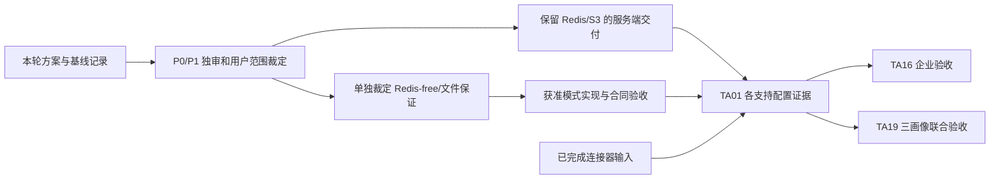

# TA01 验收设计与责任

## 本次恢复候选撤回修正

基于 718c034 的 P1 修正已提交为 `c7cf68aaf279f771a2022d37d69b5651cdb66ace`。旧程序启动前持久化 withdrawnAt 并使 validation 失效；恢复后直接 commit、安装器进程重启后 commit 均拒绝；显式重新 upgrade 须新 journal 和完整备份／迁移／健康／业务验证。控制流替身回归与真实部署分列。CI570／run39169353227 的三画像完整 guest 均报告 `withdrawnCandidateCommitRejected`、`restartedInstallerRejectsWithdrawnCandidate`、`explicitReupgradeRevalidates` 通过；原 4 CPU／4 GiB、9000 秒及逐命令期限不变。三组各核 23 输入、六脚本、候选 artifact12152451241 及同一 manifest，完整恢复／系统重启证明齐全。准确原件见 [CI570 索引](../../reviews/ta01-product/ci570-observed-status.json)。

17 个 job 全部 success，Required117818842379 成功，只绑定受测 c7cf68a；后续资料 skip-ci head 没有自身成功 Required。P1-1 已收到正式复审确认闭合，P1-2 旧 139 继续阻断。用户对原问题 `q-E6FuFFokBxxs6UpR6K9vC` 回答“先取API窗口（推荐）”，唯一一次 A 已执行：678.69秒，外层OOM／QEMU -9，无目标或最终回执，目标请求数unknown，不是139阴性样本。准确结果见[本次索引](../../reviews/ta01-product/amd64-api-crash-window-a.json)；新的VM／外层预算选项继续[待裁定](amd64-crash-investigation-plan.md#本次-a-的实际结果与新关口)，不自动补跑。B未执行；本轮无产品改动、重跑或取消CI，不送审、不合入。

## 当前验收平台：Linux amd64

用户2026-10-19 03:41批准本轮服务端只交付既有Linux amd64（x86_64）；个人／团队／企业仍须完整无源码离线、升级／回退／恢复、Redis故障、持久队列及系统重启闭环。一个不可变producer、三个独立guest及所有适用后端检查都必需，失败／取消／缺件不填通过。CI568／run39160943688@8ff1f8b三画像及Required117791572117均成功，原件各核22输入／六脚本和完整重启。只证明该候选原脚本，不关闭旧139；本次后续资料head无成功Required。

ARM服务端候选及验收延期，不再阻断本轮，也不记为通过；历史三ARM失败与原件保持。#20连接器既有双架构CI／能力不变。当前完整规格见[current-spec-amd64.md](current-spec-amd64.md)，后文双架构及ARM关口均为历史来源，原九类合同和非平台DoD责任保持。

最新源码及原生／固定amd64 guest各32轮真实API/MCP联动未支持安全产品修复。唯一一次amd64 VM为595.16秒／上限1200秒，实际65 MCP POST、33资格／32工作项GET，initialize零资格；无139只是有限负样本。下一步和缺口见[当前报告](current-delivery.md)，不自动追加VM或矩阵。历史[ARM取证关口](repair-decision-gate.md)不执行；1800秒例外已耗尽，旧失败、缺件、九类合同和全部门禁保持。

本次按用户 2026-10-14 12:27 批准的新会话方式接续。PR227 为恢复来源，本次交付和条件合入走当前会话分支；旧树保全、真实主线及双架构首败见 [接续记录](resumption.md)。产品验收尚未完成。

## CI567终态与本轮单次组件测量

CI567／run38893305755@e276终态failure，Required117011885049失败。三AMD完整重启证明保持；ARM个人／团队9000秒到期且无最终回执，最后分别restore-empty序号23／recover-old序号21开始；企业升级后commit序号16 tools/call30,443ms失败，API资格16,639.13ms／工作项8,430.75ms晚200不补成功。三份新原件各核22输入、六脚本及准确生产者，不套旧head或共同根因，见[当前报告](current-delivery.md)。

用户2026-10-16 21:48批准一次ARM组件总窗1800秒（增加600秒），不是产品／正式验收超时变更。该次[测量原件](../../reviews/ta01-product/resumption-api-auth-pg-arm-1800-once.json)实际1392.55秒、Node／PG／Redis／QEMU0，无宿主TERM；28条进度、156条连续Node事件、最终报告确认两个目标GET及8个供应请求。资格12,183.81ms／工作项3,034.26ms均在原30秒内，真实配对／逐请求鉴权／实时资格未替换。角色、ISO、PG参数、观测及缺少完整负载均保留；只证明本样本，不冒完整矩阵或关闭139。

前三次1200秒incomplete与未知请求数保持，本次批准不倒填。仅此一次例外已用，不追加第五轮。原生六份完整阶段和行锁阳性对照仍只证明局部方法；PG执行含等待，CPU含多核，不从旧21.62秒或纯函数基线相减推根因。未改产品／CI／正式期限／支持矩阵，资料skip-ci没有本head成功Required；全部原真实验收、P0/P1正式产品审及最新Required齐前不合入。

## 当前基础产品验收范围

用户已批准基础产品及现有 Linux amd64／arm64 CI、干净完整 guest。此矩阵保留原 DoD 和九类要求；本轮新增验收只覆盖 PG／Redis／S3 三画像，Redis-free／filesystem 继续列为后续未交事项，不能记已实现或移除原提案。

旧控制面基线和 docs Required CI 不替代新候选包验收。用户已批准本阶段记录例外并继续。平台 Saved plan 字段仍未同步，当前依据仓库执行计划进入产品实现；产品验收已有局部真实结果，三画像双架构完整组合尚未通过；最新准确源码、首败及未测见 [接续记录](resumption.md)。

## CI564 终态与 CI565 新候选

CI564／run38846561914绑定 `5371f16e24db94415155228dfc8ac149523573a0`，运行cancelled，Required job116816927133 failure。AMD64团队完整通过，企业回退后commit的initialize遇到MCP139。个人AMD64和三ARM均cancelled、缺result.json；只保可得串口，不补自然终态或通过。双生产者真实55项Python及16项安装单元通过，不代六guest。见[终态原件](../../reviews/ta01-product/ci564-final-results.json)。

平台checkpoint为 `ac0a4d21deba15a23c8c7b40f671b59c41f30f37`，自动触发CI565／run38852474436，与旧运行取消的并发规则及时序一致；没有独立取消发起者字段，归属按推断保留。当前CI565双生产者已核55项／16项和六脚本／manifest，AMD64三画像已核完整重启通过，三ARM均失败、Required失败、无取消：企业首次正常commit为30,382 ms，个人／团队升级夹具commit为30,392／30,602 ms；晚200均不补成功，不能套旧结果。见[生产者原件](../../reviews/ta01-product/ci565-producers.json)。

首败提前摘要已在CI564企业AMD实际送达，比最终诊断早85.72 s，最终仍失败；只为证据修正。固定Node／guest／精确QEMU版本的AMD64原生／TCG小组件与各12次零POST冷启动完成，并补准确CI563 MCP镜像角色各12组配对，以及CI565 ARM准确角色的12组合成补测；有限未139不排除故障，也不代ARM、完整已安装候选或原真实验收。具体时序、四项假设与未测见[当前报告](current-delivery.md)；原全部断言／期限和P0/P1独审、最新Required门禁保持。

## CI566 当前受测结果

受测 head `541f6ba64841915801a1ccb123f9adb7f61ebe17`；[完整终态](../../reviews/ta01-product/ci566-final-results.json)保六组、双生产者、22 输入／六脚本及真实 checkout。Required116933988732 failure，整体 failure，六组无取消。双生产者 Linux60 项 Python／16 安装单元只证明对应检查，不能代完整支持。

| 画像 | AMD64 | ARM64 |
| --- | --- | --- |
| 个人 | success，完整重启 4,274.10 s | failure，action19 commit 的 get_work_item 30,609 ms 无头／体超时 |
| 团队 | failure，action18 commit initialize 2,766 ms 重置，MCP 容器 139 | failure，原 150 分钟总期限，最后 action22 upgrade 开始，无回执 |
| 企业 | success，完整重启 4,016.89 s | failure，原 150 分钟总期限，最后 action22 upgrade 开始，无回执 |

两 AMD 通过组有不同 boot_id、两次 kernel、QMP RESET／SHUTDOWN、QEMU0 和重启后四证明。个人 ARM 首次真实 API 投影为资格 21,622.81 ms／工作项 10,019.08 ms，两者 completed／200 仍不补客户端失败；窗口缺统一关联／内部阶段，不相减为 MCP CPU 或 SQL 时间。团队 AMD initialize 未选取此分支，另外两 ARM 没有本次请求／API／journal 回执证据，不套同一根因。

独立健康／initialize 原生与 TCG 负样本、同源 ARM manifest 三次成本测量均非完整 API／真实身份事务。旧角色／合成输入、原生 ARM 缺失、尚无准确产品修复分别保留，详见[当前报告](current-delivery.md)。本轮原期限、全量包校验、PG／Redis／S3 保证和原 DoD 保持，未进入正式 P0/P1 成果审或合入。

## CI562 当前候选矩阵

普通 CI562／run38831525243 与显式 CI563／run38831565958 均绑定 `9c8bbff749c1d2a52a3e6489dcec02d2d7c859af`。四份生产者原件已核 Linux 上 52 项 Python、16 项安装单元通过，六脚本与准确 Git、manifest 相符。普通矩阵继续六组合，显式诊断仅双架构团队，诊断失败不能当支持通过。

| CI562 画像／架构 | 当前实际结果 | 证据 |
| --- | --- | --- |
| 个人 Lite／amd64 | success，完整重启证明齐全，4,068.43 s | [索引](../../reviews/ta01-product/ci562-amd64-personal-full-guest-pass.json) |
| 团队／amd64 | success，完整重启证明齐全，2,485.96 s | [索引](../../reviews/ta01-product/ci562-amd64-team-full-guest-pass.json) |
| 企业／amd64 | failure，首次健康后 API die139，MCP请求数0 | [首败](../../reviews/ta01-product/ci562-amd64-enterprise-first-failure.json) |
| 个人 Lite／arm64 | failure，总150分钟，restore-empty只见开始，无完成回执 | [索引](../../reviews/ta01-product/ci562-arm64-personal-first-failure.json) |
| 团队／arm64 | failure，总150分钟；此前串口commit业务超时，最终receipt未保存 | [索引](../../reviews/ta01-product/ci562-arm64-team-first-failure.json) |
| 企业／arm64 | failure，总150分钟，restore-empty只见开始，无完成回执 | [索引](../../reviews/ta01-product/ci562-arm64-enterprise-first-failure.json) |

CI562及Required job116795930709 failure，六组合全部结束、无取消，其余14作业成功。[双运行终态](../../reviews/ta01-product/ci562-ci563-final-results.json)保准确来源。本轮新增首败摘要提前上报及宿主pending failure仍拒绝验收的修正，55项仅为本机回归，新路径须绑定新候选实测，不冒9c8既有原件已验证。

CI563 双团队及 Required job116795308066 均 failure。AMD64 首次身份读取、首次／升级 commit 三窗口原动作成功且无 core，第四个回退后 commit 捕获自然139，原业务失败。准确公开二进制匹配后只有 IC::UpdateState+128 和两个有界公开帧，handler 开始早于 journal 本次读取约7.23秒，不能认定该读取触发故障。ARM64 首次身份及首次 commit 成功无 core，升级后 get_work_item／id2 在30,394 ms 原期限到期，上游49,798 ms 完成200不补成功。见[ARM64原件索引](../../reviews/ta01-product/ci563-arm64-team-native-observation.json)及[当前报告](current-delivery.md)；旧成功不代当前矩阵或根因闭合。

## CI561 修正候选矩阵

普通 CI561／run38815572580 绑定 `461c753c9ddca19e83a97fc31f4381427603a9ac`，tree 为 `af26442a7b06030642fa917c84dd57f5e55bf6f3`。双架构生产者各 47 项 Python、16 项安装单元通过，候选分别核准确源码、六脚本与 manifest；不能据此宣称六 guest 通过。

| 画像／架构 | 当前实际结果 | 证据 |
| --- | --- | --- |
| 个人 Lite／amd64 | success，4,101.91 s，整机重启齐全 | [索引](../../reviews/ta01-product/ci561-amd64-personal-full-guest-pass.json) |
| 团队／amd64 | failure，首次身份读取连接断开，MCP die139 | [首败](../../reviews/ta01-product/ci561-amd64-team-first-failure.json) |
| 企业／amd64 | failure，回退后 commit initialize 连接重置，MCP die139 | [首败](../../reviews/ta01-product/ci561-amd64-enterprise-first-failure.json) |
| 个人 Lite／arm64 | failure，升级后的 commit tools/call 原 30 s 超时；上游稍后完成不代客户端成功 | [首败](../../reviews/ta01-product/ci561-arm64-personal-first-failure.json) |
| 团队／arm64 | failure，回退后 commit tools/call 原 30 s 超时；上游稍后完成不代客户端成功 | [首败](../../reviews/ta01-product/ci561-arm64-team-first-failure.json) |
| 企业／arm64 | failure，升级后的 commit tools/call 原 30 s 超时；上游稍后完成不代客户端成功 | [首败](../../reviews/ta01-product/ci561-arm64-enterprise-first-failure.json) |

六组已全部结束，没有取消；CI561 与 Required job116749221401 均 failure。[终态索引](../../reviews/ta01-product/ci561-final-results.json)逐组核六脚本、生产者与 manifest，六组 stage 及首次健康均真实完成，只证明已越过此前首次安装的预算首败，不代后续全部操作通过。两份 AMD 139 未捕获 core，不套旧 CI559 位置为本次根因；三份 ARM 超时的较晚完整 200 也不记客户端成功。

后续 52 项本机检查对应收窄的显式诊断，不能冒上述真实 47 项 guest 已使用新路径。CI559 ARM64 已达原 150 分钟，只有个人三个 commit 成功、无 core，Required 失败。完整报告、原件及未闭问题见[交付报告](current-delivery.md)。以下 CI558 表保留前轮准确来源，不代 CI561 或新提交。

## CI558 当前基础矩阵

受测源码为 `f53f20b85e680a4219ae9f22a58ff37de58c37d8`，tree 为 `6868b31ac93f90d6bfb9e5149f2f01421426a2f8`。每组独立完整 TCG guest，4 vCPU、4 GiB，保原 150 分钟及业务、健康、安装期限。以下成功仅覆盖对应配置；其余组合、最新普通 Required CI、原生故障根因和正式 P0/P1 独审仍待完成，当前不可合入。

| 画像／架构 | 实际结果 | 证据 |
| --- | --- | --- |
| 个人 Lite／amd64 | 完整 guest 通过，2,081.81 s | [索引](../../reviews/ta01-product/ci558-amd64-personal-full-guest-pass.json)／[原件](../../reviews/ta01-product/ci558-amd64-personal-full-guest-pass.zip) |
| 团队／amd64 | 完整 guest 通过，2,571.94 s | [索引](../../reviews/ta01-product/ci558-amd64-team-full-guest-pass.json)／[原件](../../reviews/ta01-product/ci558-amd64-team-full-guest-pass.zip) |
| 企业／amd64 | 完整 guest 通过，1,860.15 s | [索引](../../reviews/ta01-product/ci558-amd64-enterprise-full-guest-pass.json)／[原件](../../reviews/ta01-product/ci558-amd64-enterprise-full-guest-pass.zip) |
| 个人 Lite／arm64 | cancelled，job116655073308 | [取消索引](../../reviews/ta01-product/ci558-arm64-personal-cancelled.json)，缺 result，不填通过 |
| 团队／arm64 | cancelled，job116655073593 | [取消索引](../../reviews/ta01-product/ci558-arm64-team-cancelled.json)，缺 result，不填通过 |
| 企业／arm64 | failure，job116655073569；首次安装达到 1,800 s | [首败索引](../../reviews/ta01-product/ci558-arm64-enterprise-first-failure.json)／[原件](../../reviews/ta01-product/ci558-arm64-enterprise-first-failure.zip) |

三份 amd64 回执均明确 `single-configuration`，包含安装、API/MCP/Worker、真实 429、Redis 故障关闭、丢 wakeup、重启 worker、工件、升级、兼容回退、加密备份及空目标恢复；个人另核数据绑定变化提前拒绝。各自保两个不同 boot_id、两次 kernel、QMP RESET/SHUTDOWN、QEMU 退出 0，以及重启后的鉴权 API、MCP、原工件字节和新 outbox 投递。全部使用同一生产者工件 `12005130717`，manifest SHA 为 `04be6dd70621aefb14c223a20722ee6fd6f9ccb04405fce69f387ecb7255b60a`；不将这三份成功写成整个矩阵通过。详细首败及范围见 [接续记录](resumption.md)。

显式 CI559 的 AMD64 团队升级原动作观察窗口仍自然崩溃，core 元数据与准确公开 Node SHA 匹配后定位到 V8 `IC::UpdateState`，没有完整栈，根因未闭合。原件及新有界帧链工具的本机／未测边界见 [接续记录](resumption.md#ci559-自然故障的公开位置及后续有界帧链)。普通三个 AMD64 成功不能关闭这个问题。

CI558 已终态 cancelled，Required job116693532882 为 failure。ARM 企业首败在首次安装 action6，尚无 MCP 请求。拆分后的独立团队／企业 guest 遗漏 `stage`，使导入与部署共用一次安装期限；本次修正首个请求画像的暂存分支，保每命令原期限及全部复核。新候选尚未通过真实 guest。CI560 的 `405f880` 仍含旧分支，不能承接本次修正。准确交付、取消原因与缺口见 [当前报告](current-delivery.md)。

## 原要求承接

当前完整规格见 [spec.md](spec.md)，旧原件见 [history](history/README.md)。以下用例进入已批准基础范围时必须实际执行，不能因文档检查或历史成果通过而勾选。

| 原测试项／DoD | 既有输入 | 待创建或补充的准确目标 | 责任及状态 |
| --- | --- | --- | --- |
| 空白无源码设备安装 | `scripts/verify-a2-backend-lite.mjs` 的 Git archive、镜像 save/load、无源码安装目录；#20 连接器产物 | `scripts/server-distribution/install.test.mjs`：`blankInstallWithoutSource`、`wrongArchitectureRejectedBeforeMutation`、`offlineDependencyClosure` | TA01；Linux 双架构 CI 和干净完整 guest 已批准，未测 |
| 已有版本升级／回退／卷保留 | `packages/db/integration/migration-baseline.integration.test.ts` 的 restart-idempotently、并发 runner 和 checksum 拒绝 | 同上：`upgradeKeepsOriginalVolumes`、`preMigrationFailureKeepsCurrent`、`partialMigrationStopsIncompatibleRollback`、`compatibleProgramRollback`、`restoreIntoEmptyTargetKeepsOriginal` | TA01；待创建，真实新旧版本对和 journal 故障注入必需 |
| 各支持配置完整操作链 | 后端退役 API Cookie／CSRF、provider 幂等及精确上下文；独立 MCP 配对和 Skill 下载 | `apps/api/integration/deployment-profiles.integration.test.ts`：`personalJourney`、`teamJourney`、`enterpriseJourney`；不得跳过 Worker／outbox、限流、上传下载和完整恢复 | TA01 提供配置证据；TA16 企业组合；TA19 最终联合验收 |
| 停 Redis、丢 hint、worker 重启 | coordinator 的 fallback／重复 hint；outbox 的 offline／restart／backoff／dead 测试 | 同上：`redisOutageFailsClosedCredentials`、`databaseModeHasNoRedisClient`、`lostWakeupStillReadsCommittedCursor`、`crashAfterClaimRecovers`、`consumerReplayDoesNotDuplicateEffect` | 现有 Redis 故障回归可复用；Redis-free 用例待创建且先裁定 |
| 不支持组合启动拒绝 | config 与 runtime-guard、Lite 未知角色拒绝 | `packages/config/src/deployment-profile.test.ts`：`rejectUnsupportedBeforeSideEffect`、`rejectReplicaOrStoreMismatch`、`rejectUntrustedProxyAndMissingCa` | TA01；待创建；当前未知变量不保证拒绝 |
| 固定资源及空闲／首任务／并发峰值 | 本轮[测量方法与状态](measurement.md) | `scripts/server-distribution/measure.mjs`：输出固定条件、原样 samples、errors 和 ledger；真实受限设备重新完整采样 | TA01；Docker 基线不是设备最低值，资源数字不预写 PASS |
| schema 变更 | manifest／账本／SQL 原子注册及上一阶段升级回归 | `packages/db/integration/deployment-profile-migration.integration.test.ts`：`cleanInstall`、`previousStageUpgrade`、`failureRollsBackSqlAndLedger` | 基础交付无 schema；PG 限流等获准后新增编号迁移与 SCHEMA，待创建 |
| 每项声明均可复现，无 failing required check | 当前五项 required checks 和实际 Required CI 策略 | 新组合真实演练与候选源码／镜像／环境绑定，按每个支持格给独立结果 | 旧 CI 仅作输入；本轮不报告产品 DoD 完成 |
| 完整证据、演示、限制与偏差、独审 | 本轮文档入口、来源与验证页 | 后续源代码／迁移／API／events、完整测试、演示和首败证据同次交付 | P0/P1 独审仍必需；失败与未测不能按较低审查等级豁免 |

上述待创建文件及用例名是冻结的实施目标。基础安装、升级、配置、真实恢复及三画像用例已获准；Redis-free／filesystem 专属用例保持后续待裁定。后续保证批准改变目标时，须明确修订并保留历史原件。

## 九类适用测试

当前新增入口已经创建：`packages/config/src/deployment-profile.test.ts` 校配置拒绝；`scripts/server-distribution/install.test.mjs` 校清单、账本、程序兼容、目录锁及 journal；`apps/api/integration/deployment-profiles.integration.test.ts` 校匿名请求没有状态／event／outbox 写入。完整三画像由 `scripts/server-distribution/guest.py` 的 `journey`、`upgrade_recovery` 和重启分支执行，安装器单元不能代替 guest。

| 已创建入口／真实范围 | 当前状态 |
| --- | --- |
| guest：API 安装、Cookie／CSRF、provider 私有 CA HTTPS、配对 MCP、上传／worker 验证／下载 | 未执行完成；首批候选不宣称支持 |
| guest：真实凭据 429／Retry-After、停 Redis 的凭据失败关闭、停 worker 时 PG outbox 留存、重启后 delivered、并发请求和周期采样 | 未执行完成；新增 realCredentialRateLimit429 尚待新候选实测，Root 集成回归是独立输入 |
| guest：同程序两候选升级、完整加密备份、兼容回退、真实未知账本拒绝、健康失败后实际停止不兼容候选、独立空目标恢复、原卷身份 | 未执行完成；不是两个已发行历史程序版本，裸 Compose 迁入未实现 |
| guest：两次 kernel／boot_id 与 QMP RESET／SHUTDOWN，实际已安装服务重启 API／MCP 读取、原工件字节和新 outbox 投递 | 未执行完成；不以 hosted 架构标签或 Docker healthy 代证 |
| 根 lint／typecheck／test／integration／conformance；独立恢复 opt-in | 38a8923 加正式 Pi 摘要测试修正的规范五门禁全部通过，695 个输入前后相同，无临时观测／preload；此前 M5 首败及观测另保。根 recovery opt-in 仍跳过，CI549 真实 PG／S3 恢复和恢复后生产镜像 smoke 另通过。后续诊断修改的21项 Python／15项安装单元通过，新完整 CI 待执行；CI549 AMD64 团队回退后 MCP 初始化连接重置，ARM64 个人升级后工具读取超时，双架构及 Required 失败。准确源、首败与收尾见 resumption.md，当前不能合入 |

下面的历史冻结用例名继续保留。已有等效入口的真实名字和范围以上表为准；尚未完成的新场景仍是待创建或待执行责任，不因函数、配置或旧测试存在而勾选。Redis-free／filesystem 专属用例维持后续裁定。

既有真实用例复用包括 `apps/worker/integration/outbox-recovery.integration.test.ts` 的 `restarts after a committed claim and delivers the recovered event to the receiver`、`keeps a Redis hint pending while offline and delivers it after recovery`；`packages/db/integration/migration-baseline.integration.test.ts` 的上一阶段原子升级／失败回滚；`packages/recovery/integration/recovery.integration.test.ts` 的 `backs up, safely resumes an interrupted empty-target restore, and verifies all state`。越权、撤权和字段读取沿 `apps/api/integration/route-policy-authorization.integration.test.ts` 的现行真服务断言，不能将 fake actor／provider 说成企业实网身份验收。

| 类别 | 具体场景与现有复用 | 后续新用例 |
| --- | --- | --- |
| happy path | backend-retirement 的 `liteInstallCookieCsrf`、`liteProviderConnectionReplay`、`liteExactProjectContext`；恢复整体链 | `personalJourney`／`teamJourney`／`enterpriseJourney`，每格含工件读回和恢复 |
| 越权 | Cookie／CSRF 缺失、其他 Human、撤权后的读取拒绝；Session、delegation、capability、scope 沿领域测试 | `crossTeamArtifactAndProfileReadDenied`、`revocationDuringUploadDenied` |
| 非法状态 | 已结束 Session 写入拒绝，已完成／取消 intent；失效 journal 和不兼容回退 | `terminalSessionCannotWriteInAnyProfile`、`invalidInstallJournalRefused` |
| 重复幂等 | provider 同 key 原响应与异体拒绝；安装并发控制 | `installRetryUsesSameJournalIdentity`、`uploadFinalizeReplaySameResult` |
| 旧 revision | API mutation 的 If-Match；画像不能绕过领域入口 | `staleRevisionRejectedInEveryProfile` |
| 事务失败 | migration SQL／ledger、领域 state／event／outbox 同事务 | `profileMutationRollbackKeepsStateEventOutboxAligned`、`limiterAtomicMultiDimensionFailure` |
| webhook／job 重放 | outbox／webhook 真实 worker＋fake Agent；恢复重放不重做外部效果 | `consumerReplayDoesNotDuplicateEffect`、`restoreJournalSameTargetReplay` |
| 并发 | 三维限流、上传同对象、双安装器、双迁移器和资源 fencing | `concurrentInstallHasOneOwner`、`concurrentLimiterOneBudget`、`concurrentUploadNoOverwrite` |
| 重启／outbox 恢复 | coordinator 的 startup／restart；worker claim 后恢复；recovery 中断 journal | `crashAfterClaimRecovers`、`restartBetweenFileAndMetadataCommit`、`restartDuringUpgradeKeepsDeterminateState` |

领域九类全部适用于最终产品组合；基础产品实现保持领域 mutation 入口，复用并执行既有领域回归和新增部署组合验收。测量中使用既有 API 写入独有测试库，不等于新功能 happy path 验收。

后续 `apps/api/integration/deployment-profiles.integration.test.ts` 承载 API 场景；store 单元与 conformance 另建 `apps/api/src/auth-rate-limit/database-store.test.ts`、`packages/artifact-storage/src/filesystem.test.ts`。真实 Redis／PG／S3 用例与 fake store 场景分列，不以模拟结果代替真实原子性、锁、限流或保留。

## 基础、保证与联合验收顺序

保证分支未获准时，不纳入基础交付的支持矩阵；图中合流表示获准后补其证据，不要求未批准模式阻塞已保留 Redis/S3 的基础范围。TA19 全卡完成仍受其其他责任卡依赖约束，本方案不取消这些依赖。

## 真实环境条件与命令

个人设备验收要冻结 OS、架构、Docker／Compose、CPU／RAM、磁盘介质及容量、网络和 CA；团队另冻结人数、并发和数据量；企业另冻结身份、内网 Git／模型／S3 及受限出网规则。当前未提供的条件保持待裁定，不默认申请新设备、凭据或真实外发。连接器自身 D-Bus／Secret Service 条件沿 #20，不接管其实现。

后续产品执行 `pnpm lint`、`pnpm typecheck`、`pnpm test`、`pnpm test:integration`、`pnpm test:conformance`，再运行每格安装／API／MCP／Worker／限流／工件／恢复闭环。根 `test:e2e` 已不存在，历史后端断言按当前入口承接，不恢复浏览器 CI。

复用实测入口包括 `pnpm validate:lite`、`pnpm validate:production-images`、`node scripts/verify-a2-backend-lite.mjs`、`pnpm verify:integration-examples --recovery-checks`。最后一项的恢复套件为显式 opt-in；只跑普通 integration 成功不能表示已运行恢复。全部仅对准确独有测试库和 bucket 运行。

后续新增用例的生产 build 排除、unit／integration／conformance 分类和必需 CI 消费必须同步核实，不能把测试文件存在当执行证据。源码、runner checkout、镜像身份、原日志、未测及资源收尾分别绑定。
## 最新候选验收状态

CI550／551 均受测 fbb59cf0181cd8f5876770e568bf620d25c47d4d，双架构服务端与 Required CI 均失败。普通 AMD64 达到150分钟总期限；ARM64 个人升级后 MCP tools/call 达原30秒读取期限。AMD64 显式诊断捕获 Node 退出139，GDB超时、没有可用栈；ARM64未到该团队目标。各轮其他12项成功不代产品完整验收。

后续保全部三画像、恢复、重启和原期限：完整文件校验最多两个工作线程，新增安全 core 相对位置及超时部分栈，ARM64 显式诊断观察个人升级提交，失败快照加本安装 PG 只读连接数聚合。26项 Python、16项安装单元和隔离 PG 聚合采集通过只覆盖工具边界，不覆盖 TCG 性能、根因或支持矩阵。新候选普通 Required CI、双架构完整 guest 及正式 P0/P1 成果独审均待完成，当前不可合入。准确首败、源码和资源账本见 [接续记录](resumption.md)。
CI552 AMD64在企业回退后的commit实际退出139，个人和团队profile-completed、企业business-committed不代整机重启或完整支持；PG聚合快照100／3不能解释原生故障。CI553两架构旧单窗口提交成功、没有自然core，不据此关闭旧问题，其Required仍失败。下一显式诊断覆盖三画像首次／升级／回退九个正常提交，原动作各一次、拒绝即停，窗口回执非产品通过，普通全链和原期限保持。30项工具边界检查通过只覆盖该助手，新guest、根因与正式P0/P1独审仍待完成；普通ARM64终态待取。见 [接续记录](resumption.md)。
CI552普通ARM64终态失败，个人升级commit的tools/call在30,557 ms超时；当前程序健康、无重启，PG快照20／3／off不能推先前连接状态。CI552与553的Required均失败。后续保原请求和期限，加测试代理最近8条／最多128次的固定阶段观察，不含正文或身份、不新增请求。33项本机检查含真实HTTP等待响应体的单请求用例，但TLS为stub，不代私有CA、guest或完整支持。两轮原件、准确源码与后续边界见 [接续记录](resumption.md)。
CI555显式诊断因源码核查发现首次commit观察会误认旧失败读取而主动普通取消；双架构取消原件无result.json，不补产品结论或guest收尾。普通CI554仍执行，未被取消。新助手只认同journal本次追加的唯一读取，核旧记录前缀不变；34项本机回归通过，新的guest未测，旧33项原件保留。公开Node索引与目标SHA匹配尚待，不能当故障证据。见 [接续记录](resumption.md)。
## 后续六组合执行与证据范围

普通验收改为每画像／架构一个完整guest，共六组；每VM保持4 vCPU／4 GiB、原150分钟及原请求／健康／安装／服务oneshot、故障、恢复与重启要求。每架构总预算因三台VM而增加，不冒总体性能提升或旧时限通过。每架构只构建一次候选，三组按不可变工件ID与生产者SHA复用；Required同时要求两生产者及六普通guest全部成功，删任一格或吞失败拒绝。

单配置结果明确scope与profilesRequested，前后范围相同；API／MCP／工件／新outbox及boot_id／kernel／QMP分别实核，单份不代整矩阵。默认助手仍三画像；显式诊断非验收，每窗口独有标记与回执，出现core处理回执即停，不重用旧结果。40项Python／22项门禁本机检查通过只证明工具边界，首轮夹具NameError及原源码未留字节的事实保留，真实新组合与根因尚未闭合。CI554 AMD64团队回退提交再次die139，代理停于已发送上游请求、未收响应头，较晚重启健康不冒未崩溃。见 [接续记录](resumption.md)。
