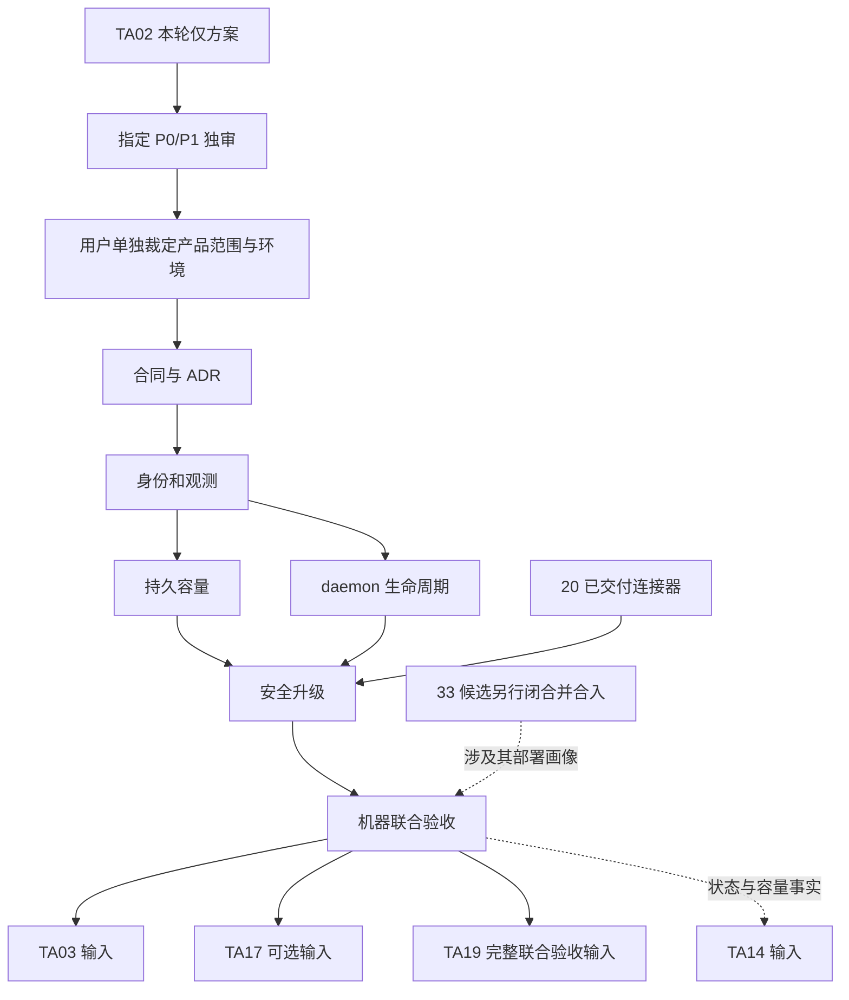

# 仅方案交付计划与未来实施顺序

## 本轮执行范围

执行本计划当前只形成完整中文方案、当前规格、来源和适用文档检查回执。所有 P 阶段产品任务都是未来建议，均未授权启动；确认方案、独审通过或平台阶段改变不自动授权它们。

| 本轮步骤 | 产物 | 完成依据 |
| --- | --- | --- |
| L1 核对基线和原件 | [sources.md](sources.md)、[当前规格](current-spec.md)与 sources 原件 | 实际 refs/heads/main 与 HEAD；完整 Spec；Accepted/Proposed 按原文区分；#33 未合入单列 |
| L2 现状与设计 | [design.md](design.md)、[决策草案](proposed-decisions.md) | 每个原目标有现有路径、新增范围和待裁定差异；无实际合同或权限变更 |
| L3 测试与检查 | [acceptance.md](acceptance.md)、[verification.md](verification.md) | 九类及原 DoD 逐项承接；只执行适用文档检查；实际 CI 与未执行分开 |
| L4 独立审查交接 | 本分支文件和平台 #34 review | 指定独审者 `_oYMSdl7L0Y6M9c4IB-PD` 仅审 P0/P1；不合入、不实施、不启动其他卡 |

当前工具没有 WorkMesh Project/WorkItem/Activity 写能力，也没有保存平台计划的工具。本轮沿原卡明确的 Todos＋仓库记录例外，平台 #34 和本文件为稳定关联；未建立或伪造真实 WorkMesh 记录。后续若另获控制面写权限，再补精确任务正文、测试、DoD、blocks 和活动，不为同步默认申请凭据。

## 未来阶段及门禁

产品阶段需要用户单独批准范围、D1—D6、环境和权限。以下任务不派工、不创建新的平台 todo，不修改既有卡依赖；负责人按模块记，具体执行者由后续派发确认。每一行都承接[验收矩阵](acceptance.md)的原 DoD，不得以分项通过关闭整卡。

| 阶段 | 未来变更与复用 | 测试及阶段 DoD | 后继 |
| --- | --- | --- | --- |
| P0 冻结合同 | 重新核 main；确认 Proposed ADR、D1—D6、具体平台、feature、锁序和 threat boundary；先改协议、OpenAPI、Zod、route-policy | 冻结所有新增路径与用例名；逐项核现行不变量；P0/P1 独审及具体产品批准 | blocks P1 |
| P1 身份和观测 | 待创建 machine contracts/domain/db；复用 Connection 引导、系统秘密和权限投影；新编号迁移与 SCHEMA | T1/T2/T4/T5/T6/T9；空库／上一阶段迁移，跨 Team、撤销／轮换、乱序报告通过；未知不伪造在线 | blocks P2、P3 |
| P2 持久容量 | 新机器 admission/slot 表及 worker 调度；接原 Attempt claim/start/settle、wait、Stop 和 outbox | T3—T9、S1/S2；双机器／双进程、排队、固定目标、公平性、事务回滚和迟到 fencing 通过；Agent 计数不变 | blocks P4 |
| P3 daemon 生命周期 | 用户级独立 daemon/CLI；复用私有路径、OS 锁、脱敏和版本信息；新 supervisor 适配 | T2/T3/T8/T9、S3；foreground/background 互斥、崩溃／断网、Windows 后台、停止与 journal 恢复实测 | blocks P4 |
| P4 受控升级 | 衔接 #20 校验与 installer；drain、候选撤回、健康／回退、D5 选定信任链 | S4；错误架构／摘要／来源／协议拒绝，升级前后重启恢复、旧版本兼容和进行中结果实测；不改原 pending 身份 | blocks P5 |
| P5 接入和联合验收 | API/SDK/MCP/CLI 查询一致，维护 integration 中文说明、配置和可运行示例；汇总准确 source/producer/target | 全九类、原 DoD、精确 HEAD Required CI、选定 x86 平台实测和 P0/P1 成果独审；未裁定／未测项不能写可用 | 提供下游输入 |

各阶段冻结后必须把新增测试名同步到当前 WorkItem 描述和活动；本页的“待创建”只是未来路径建议。产品实现不得先写 runtime 再补协议与迁移。缺任何阶段 DoD、实际 CI 或必需设备验收都不能关闭整卡。

## 未来文件责任

| 模块 | 已有准确路径 | 待创建／改动责任 |
| --- | --- | --- |
| 合同／领域 | `packages/contracts/src/index.ts`、`packages/domain/src/index.ts` | 新 `machine.ts`／`machine-admission.ts` 及共享 DTO；保持纯领域不导入 Fastify/Redis/provider |
| 数据与锁序 | `packages/db/src/agent-concurrency.ts`、`schema.ts`、`migrations/v1/` | 新机器 repository、复合 FK／唯一约束／队列索引；编号按未来 main；现有 Agent 计数断言不删除 |
| API | `apps/api/src/workbench-runner.ts`、`agent/commands.ts`、`agent/execution-origin.ts`、`configuration-readiness.ts` | 新机器 routes/application 命令；路由只转换传输；按是否获准调整 readiness，不将旧心跳推成在线 |
| worker | `apps/worker/src/index.ts`、`session-lifecycle.ts`、`packages/db/src/workbench-execution-waits.ts` | 新 `machines.ts` 和有界调度／回收；复用 outbox 和等待，不建立第二套执行状态机 |
| Runner | `apps/agent-runner/src/run-session.ts`、`execution-lifecycle.ts` | 对接机器领取、epoch 和 slot；保原 exact Session、Attempt、tool replay、未知副作用与 Stop |
| daemon／CLI | `apps/connector/src/platform-security.ts`、`commands.ts`、`output-redaction.ts` | 位置建议为 `apps/machine-daemon/`（待创建），是否独立包在 P0 冻结；先复用组件，不复制凭据系统 |
| 安装发行 | `apps/connector/scripts/install-entry.ts`、`release-schema.ts`、`build-release.mjs` | P4 获准后增 daemon 产品闭包及兼容校验；既有连接器产物和三系统回归不删除 |
| SDK／MCP／手册 | `packages/agent-sdk/src/index.ts`、`apps/mcp/src/index.ts`、`discovery.ts`、`docs/integration/` | 同次维护真实消费、发现资格、安全错误与恢复；本轮没有改变以上文件 |

文件路径存在性由本轮专项核验登记。未来新包名、API 路由和编号可在 P0 调整，但必须同步路径和矩阵，不得将计划路径当成已经存在。

## 依赖与接续

本卡原 requires 无新增硬前置，finalRequires 为 #20；TA00 主线已记载其交付。#33 不阻塞本轮规划，也不强加为所有产品实现的统一前置。P0 依届时 main 判断能否独立落地；凡验收使用 #33 新安装器、Lite/团队企业新画像或其 API/MCP 组合，必须等对应缺陷闭合、准确版本合入及所需门禁通过。

TA03 负责受控 coding 工作区、隔离和检查点；TA04 负责外部运行时适配；TA12 负责秘密投递治理；TA14 决定 occurrence；TA17 负责独立远程终端。TA02 不因提供机器资源便实施这些功能，也不授予 shell 或跨机器执行权。

## 交付与回退责任

本轮回退仅涉及新文档，通过正常审查撤回即可，不涉及数据或运行服务。未来产品回退见 [acceptance.md](acceptance.md)；若迁移已写入新事实，默认保留表与审计，关闭新 admission 后再回退兼容程序，禁止直接 down migration 删除执行证据。

产品交付报告须列真实代码／迁移／API/event 变更、准确提交与实测平台、命令结果、首败、演示、未知和规格偏差。任何 D 选项未裁定、必需检查失败或必需实测未完成，都不能以仅 P0/P1 审查范围豁免。
